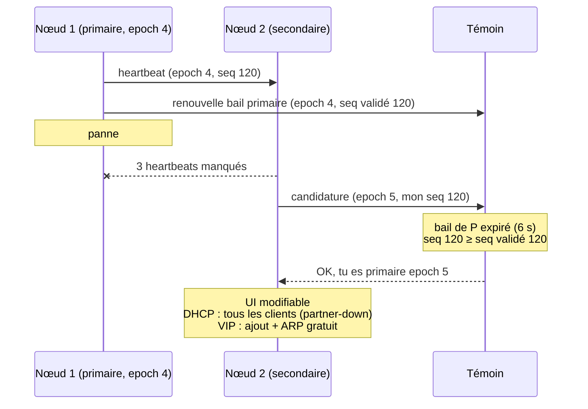

# Leazone — Plan v1

> Statut : **brouillon à valider**. Aucun code n'est écrit avant validation.
> Les points à trancher sont regroupés à la fin (§ 12).

---

## 1. Vue d'ensemble

```
                 ┌──────────────────────── binaire unique `leazone` ────────────────────────┐
 clients DNS ──▶ │ dns/      serveur, zones, cache, redirecteurs (UDP/TCP/DoT/DoH)            │
 clients DHCP ─▶ │ dhcp/     serveur v4, étendues, relais, option 82, HA par hash MAC         │
 navigateur ───▶ │ api/ + web/ (React embarqué)  ── auth/ (Argon2id, passkeys, TOTP, sessions)│
 autre nœud ───▶ │ cluster/  heartbeat, élection, synchro config + baux, témoin, VIP          │
                 │ netif/    détection interfaces/VLAN (netlink, à chaud)                     │
                 │ store/    SQLite (config + état), migrations                               │
                 └───────────────────────────────────────────────────────────────────────────┘
```

Principes :
- Un seul processus, un seul binaire statique (`CGO_ENABLED=0`).
- **Deux types de données**, synchronisées différemment :
  - **Config** (zones, étendues, comptes, clés…) : écrite seulement par le primaire, journal de changements numéroté (epoch + version).
  - **État** (baux, sessions, compteurs d'échecs, audit) : écrit par chaque nœud, envoyé en temps réel à l'autre.
- Les enregistrements DNS automatiques (baux DHCP) ne sont **pas** de la config : chaque nœud les calcule à partir de la table des baux. Les deux nœuds ont donc les mêmes.
- Tout ce qui dépend de l'hôte (interfaces, VLAN) est **détecté**, jamais créé.

### Sous-commandes du binaire

| Commande | Rôle |
|---|---|
| `leazone serve` (défaut) | Lance le nœud |
| `leazone witness` | Lance le témoin seul (pas de DNS/DHCP/UI) |
| `leazone healthcheck` | Utilisé par le `HEALTHCHECK` Docker |
| `leazone admin reset-mfa <user>` | Secours : réinitialise le MFA |
| `leazone admin reset-password <user>` | Secours : nouveau mot de passe affiché une fois |
| `leazone backup [-o fichier]` / `leazone restore <fichier>` | Sauvegarde / restauration YAML |
| `leazone migrate status\|up\|down --to N` | Migrations de base |
| `leazone caps` | Affiche les capabilities effectives (diagnostic) |
| `leazone version` | Version, version de schéma, version du protocole cluster |

Les commandes `admin`, `backup`, `healthcheck` parlent au processus via un **socket Unix local** (`/tmp/leazone.sock`, droits 0600, propriétaire `leazone`). Donc `docker exec` suffit, rien n'est exposé sur le réseau.

---

## 2. Arborescence du dépôt

```
cmd/leazone/                 main + sous-commandes
internal/
  app/                       démarrage, arrêt propre, câblage
  config/                    leazone.yaml + LEAZONE_* + LEAZONE_*_FILE
  store/                     SQLite, migrations/ (up/down), accès aux tables
  netif/                     interfaces, VLAN, bonds, bridges + abonnement netlink
  caps/                      capabilities Linux (lecture + passage en "effective")
  dns/                       serveur, zones, cache, ACL récursion, redirecteurs
  dhcp/                      serveur v4, choix d'étendue, allocation, baux, opt. 82, ping
  dhcp/v6/ (vide)            emplacement prévu, interfaces Go déjà neutres v4/v6
  ddns/                      baux → A + PTR
  cluster/                   nœuds, élection, journal, synchro, conflits
  witness/                   serveur témoin
  vip/                       IP virtuelle (ARP gratuit)
  auth/                      mots de passe, webauthn, totp, codes, sessions, limites, rôles
  api/                       handlers HTTP, middlewares (CSRF, en-têtes, ACL IP)
  audit/                     journal d'audit chaîné (hash)
  tlsmgr/                    auto-signé, import
  secrets/                   chiffrement des secrets (AES-256-GCM)
  modules/blocking/          blocage pubs
  modules/dnssec/            signature + validation
  metrics/ logs/ backup/ importer/technitium/
api/openapi.yaml             spec OpenAPI 3.1 (source de vérité)
web/                         React + TS + Vite + Tailwind + shadcn/ui
compose/                     single.yml, ha-node1.yml, ha-node2.yml, witness.yml, .env.example
test/integration/            compose de test + scénarios
docs/
Dockerfile
```

Bibliothèques Go en plus de la stack imposée (toutes en Go pur) :
- `github.com/vishvananda/netlink` : interfaces, VLAN, adresses, événements à chaud, ajout de la VIP.
- `github.com/prometheus/client_golang` : métriques.
- `gopkg.in/natefinch/lumberjack.v2` : rotation des fichiers de log.
- `kernel.org/pub/linux/libs/security/libcap/cap` : capabilities (fonctionne sans CGO).
- `github.com/oapi-codegen/oapi-codegen` : types Go générés depuis `openapi.yaml`.

---

## 3. Schéma de la base

Fichiers :
- `/data/leazone.db` : config + état (SQLite, mode WAL).
- `/data/logs.db` : journaux de requêtes DNS et événements DHCP (non synchronisé, rétention en jours + taille max).
- `/data/keys/` : clé maître locale (nœud seul) chiffrée/protégée 0600.
- `/data/tls/` : certificats importés par fichier.
- `/data/backups/` : copie automatique avant migration (5 dernières).

Légende : **C** = config (journal, primaire seulement) · **E** = état (temps réel, chaque nœud) · **L** = local (jamais synchronisé).

### Cluster et méta
| Table | Type | Colonnes principales |
|---|---|---|
| `meta` | L | `key`, `value` (schema_version, node_id, cluster_id) |
| `cluster_nodes` | C | `id`, `name`, `cluster_url`, `preferred_role`, `dhcp_buckets`, `added_at` |
| `cluster_local` | L | `epoch`, `applied_seq`, `role`, `primary_id`, `last_sync_at` |
| `changelog` | C | `seq` (PK), `epoch`, `ts`, `actor`, `entity`, `entity_id`, `op` (put/delete), `payload` (JSON), `hash` |
| `conflicts` | L | `id`, `epoch`, `seq`, `entity`, `payload`, `detected_at`, `status` |
| `failover_events` | E | `id`, `ts`, `from_node`, `to_node`, `epoch`, `reason` |

### Réseau
| Table | Type | Colonnes |
|---|---|---|
| `vlans` | C | `id`, `vlan_id` (1-4094), `name` (« Invités ») |
| `interface_settings` | C | `if_name` (ex `eth0.20`), `dns_enabled`, `dhcp_enabled`, `extra_listen_ips` |

L'état réel des interfaces (IP, parent, type) n'est **pas** stocké : il vient de netlink.

### DNS
| Table | Type | Colonnes |
|---|---|---|
| `zones` | C | `id`, `name`, `kind` (primary/reverse), `auto` (créée depuis une étendue), `soa_*`, `serial`, `dnssec_enabled`, `nsec_mode` |
| `records` | C | `id`, `zone_id`, `name`, `type`, `ttl`, `data` (JSON typé par type) |
| `forwarders` | C | `id`, `domain` (vide = global), `position`, `protocol` (udp/tcp/dot/doh), `address`, `port`, `tls_name`, `tls_verify`, `doh_url`, `enabled` |
| `settings` | C | `key`, `value` JSON (cache TTL min/max, réseaux récursion, MFA, sessions, modules…) |

### DHCP
| Table | Type | Colonnes |
|---|---|---|
| `dhcp_scopes` | C | `id`, `vlan_ref`, `name`, `mode` (direct/relay/both), `if_name`, `network` (CIDR), `relay_giaddrs`, `range_start`, `range_end`, `lease_time`, `gateway`, `dns_servers`, `domain`, `ntp_servers`, `ddns_domain`, `ddns_enabled`, `ping_check`, `alert_pct` (80), `enabled` |
| `dhcp_exclusions` | C | `scope_id`, `start`, `end` |
| `dhcp_options` | C | `scope_id`, `code`, `kind` (ip/ips/string/u8/u16/u32/bool/hex), `value` |
| `dhcp_reservations` | C | `id`, `scope_id`, `mac`, `client_id`, `ip`, `hostname`, `options` |
| `dhcp_leases` | E | `scope_id`, `ip` (PK avec scope), `mac`, `client_id`, `hostname`, `state` (offered/bound/released/expired/declined), `starts`, `ends`, `owner_node`, `circuit_id`, `remote_id`, `giaddr`, `hlc` (horloge logique), `updated_by` |

### Modules
| Table | Type | Colonnes |
|---|---|---|
| `block_lists` | C | `id`, `name`, `url`, `format` (hosts/domains/adblock), `enabled`, `refresh_hours` |
| `block_lists_data` | E | `list_id`, `fetched_at`, `sha256`, `blob` (gzip, téléchargé par le primaire) |
| `block_rules` | C | `id`, `domain`, `kind` (allow/deny) |
| `block_policies` | C | `id`, `target_kind` (interface/vlan/cidr), `target`, `enabled` |
| `dnssec_keys` | C | `id`, `zone_id`, `role` (KSK/ZSK), `algorithm` (13/15), `key_tag`, `public`, `private_enc`, `state`, `publish_at`, `active_at`, `retire_at`, `remove_at` |

### Comptes et sécurité
| Table | Type | Colonnes |
|---|---|---|
| `users` | C | `id`, `username`, `role` (admin/operator/readonly), `password_hash`, `mfa_setup_required`, `disabled`, `created_at` |
| `webauthn_credentials` | C | `id`, `user_id`, `name`, `credential_id`, `public_key`, `aaguid`, `transports`, `flags`, `created_at` |
| `webauthn_usage` | E | `credential_id`, `sign_count`, `last_used_at` (fusion : max) |
| `totp` | C | `user_id`, `secret_enc`, `confirmed_at` |
| `totp_usage` | E | `user_id`, `last_counter` (anti-rejeu, fusion : max) |
| `recovery_codes` | C | `id`, `user_id`, `code_hash` |
| `recovery_usage` | E | `code_id`, `used_at` (fusion : union) |
| `sessions` | E | `id_hash`, `user_id`, `created_at`, `expires_at`, `last_seen` (local), `ip`, `user_agent`, `auth_level`, `elevated_until`, `revoked` |
| `api_tokens` | C | `id`, `user_id`, `name`, `prefix`, `secret_hash`, `scope` (read/write), `expires_at`, `revoked_at` |
| `login_guard` | E | `key` (ip:… / user:…), `failures`, `locked_until` |
| `audit_log` | E | `id`, `ts`, `node_id`, `actor`, `ip`, `action`, `target`, `details`, `result`, `prev_hash`, `hash` |
| `certificates` | C | `id`, `source` (import/selfsigned), `domains`, `cert_pem`, `key_enc`, `not_after` |

### Secrets
- Une **clé de données (DEK)** AES-256 chiffre : secrets TOTP, clés privées DNSSEC, clés TLS, CA du cluster.
- Nœud seul : DEK protégée par une clé maître locale (`/data/keys/master.key`).
- Cluster : DEK protégée par une clé dérivée (Argon2id) de la **clé de cluster** (`LEAZONE_CLUSTER_KEY_FILE`). Même DEK sur tous les nœuds → chaque nœud déchiffre les secrets répliqués.
- Mots de passe, codes de secours, jetons d'API : **hachés**, jamais chiffrés ni stockés en clair.

### Migrations
- Fichiers SQL `NNNN_nom.up.sql` / `NNNN_nom.down.sql` embarqués.
- Au démarrage : `VACUUM INTO /data/backups/leazone-<date>-s<N>.db`, puis migrations dans une transaction.
- Retour arrière : `leazone migrate down --to N` (lancé avec la nouvelle version **avant** de redescendre d'image) ou restauration de la copie.

---

## 4. Format de l'API

- REST JSON sous `/api/v1`, spec **OpenAPI 3.1** écrite à la main dans `api/openapi.yaml` :
  - code Go (types + interface serveur) généré par `oapi-codegen`,
  - client TypeScript généré par `openapi-typescript`,
  - spec servie sur `/api/v1/openapi.json`.
- Erreurs au format **RFC 9457** (`application/problem+json`) avec un `type` stable, ex. :
  - `…/not-primary` (409) + `primary_url` → l'UI affiche le lien vers le primaire,
  - `…/step-up-required` (403) → l'UI demande passkey/TOTP,
  - `…/version-conflict` (412) → quelqu'un a modifié l'objet entre-temps.
- Listes : `?limit=&cursor=&sort=&q=` + filtres (`?vlan=20`).
- Concurrence : chaque objet a un `etag` ; les `PUT/PATCH/DELETE` envoient `If-Match`.
- Temps réel : **SSE** sur `/api/v1/events` (baux, état cluster, stats). Plus simple que WebSocket et passe la CSP.
- Auth : cookie de session **ou** `Authorization: Bearer lz_…` (jetons). Les jetons n'utilisent pas de cookie, donc pas de CSRF pour eux.

Principales routes :
```
POST   /auth/login                 (mot de passe)       POST /auth/passkey/begin|finish (sans mot de passe)
POST   /auth/mfa/passkey|totp|recovery                  POST /auth/step-up/...        POST /auth/logout
GET    /me   /me/sessions   /me/passkeys   /me/totp   /me/recovery-codes   /me/tokens
GET    /interfaces          PATCH /interfaces/{name}    GET|POST|PATCH|DELETE /vlans
CRUD   /zones  /zones/{id}/records   /forwarders  POST /forwarders/{id}/test   POST /dns/cache/flush
CRUD   /dhcp/scopes  /dhcp/scopes/{id}/reservations
GET    /dhcp/leases?vlan=   DELETE /dhcp/leases/{scope}/{ip}   POST /dhcp/leases/{scope}/{ip}/reserve
CRUD   /blocking/lists /blocking/rules /blocking/policies   POST /blocking/refresh  POST /blocking/pause
GET    /dnssec/zones/{id}  POST /dnssec/zones/{id}/enable|disable  GET /dnssec/zones/{id}/ds
GET    /cluster   POST /cluster/resync   POST /cluster/failback   GET /cluster/conflicts
CRUD   /users   POST /users/{id}/reset-mfa
GET    /audit   /logs/dns   /logs/dhcp   GET /stats/dashboard
GET|PUT /settings/{section}   POST /backup   POST /restore   POST /import/technitium
GET    /health (public, minimal)     GET /metrics (jeton dédié)
```

Rôles appliqués par route (table unique dans le code, testée) :

| Action | admin | opérateur | lecture |
|---|:-:|:-:|:-:|
| Lire (hors secrets) | ✔ | ✔ | ✔ |
| Enregistrements DNS, baux, réservations | ✔ | ✔ | ✖ |
| Zones, redirecteurs, étendues, interfaces, modules | ✔ | ✖ | ✖ |
| Utilisateurs, HA, paramètres, sauvegarde, clés DNSSEC | ✔ | ✖ | ✖ |

Droit effectif d'un jeton = **le plus faible** entre son scope (lecture/écriture) et le rôle de son propriétaire.

---

## 5. Interfaces, VLAN et écoute

- `netif` lit les liens via netlink : type (physique, `vlan`, `bond`, `bridge`), parent, ID VLAN, IP, état.
- Abonnement aux événements netlink (`RTM_NEWLINK/DELLINK/NEWADDR/DELADDR`) → **réconciliation à chaud** des sockets DNS et DHCP (pas de redémarrage).
- DNS : écoute **seulement** sur les IP des interfaces activées (+ VIP si présente). Jamais `0.0.0.0` par défaut.
  - Bonus : on ne touche pas à `127.0.0.53`, donc pas de conflit avec systemd-resolved tant qu'on n'écoute pas en joker.
- Au démarrage, si une IP:53 est déjà prise → message clair :
  `Port 53 déjà utilisé sur 0.0.0.0 (souvent systemd-resolved). Solution : DNSStubListener=no dans /etc/systemd/resolved.conf puis systemctl restart systemd-resolved.`
- Ports par défaut : 53/udp+tcp (DNS), 67/udp (DHCP), 8443/tcp (UI + API, derrière nginx), 7443/tcp (cluster mTLS).

---

## 6. DNS

- Serveur `miekg/dns` UDP + TCP par IP d'écoute.
- Ordre de traitement d'une requête :
  1. ACL : récursion seulement pour les réseaux autorisés (les zones locales restent servies à tous les réseaux d'écoute).
  2. Module blocage (si actif et si la politique couvre ce client/interface/VLAN).
  3. Zones locales (primaires + inverses + enregistrements DHCP auto) → réponse autoritaire.
  4. Cache (TTL min/max, cache négatif RFC 2308, taille max LRU).
  5. Redirecteur conditionnel le plus précis, sinon redirecteurs globaux.
- Redirecteurs : UDP (repli TCP si tronqué), TCP, DoT (RFC 7858, connexions réutilisées), DoH (RFC 8484, HTTP/2).
  - Vérification TLS on/off + nom attendu, bouton « Tester » (requête réelle, latence + erreur lisible).
  - Bascule au suivant en cas d'échec, mise en quarantaine courte du redirecteur en panne.
- Zones inverses auto : une zone `in-addr.arpa` par /24 couvert par chaque étendue.
- Enregistrements DHCP : A dans `ddns_domain` de l'étendue + PTR. Ne remplace **jamais** un enregistrement manuel. Supprimés à l'expiration ou libération du bail.

---

## 7. DHCP multi-VLAN

### Choix de l'étendue (isolation stricte)
```
paquet reçu
 ├─ giaddr = 0 (direct) ──▶ étendue liée à l'interface de réception (SO_BINDTODEVICE)
 └─ giaddr ≠ 0 (relais) ─▶ option 82 sous-option 5 / option 118 si présente,
                           sinon étendue dont le réseau contient giaddr
aucune étendue trouvée ──▶ paquet ignoré (jamais de repli vers une autre étendue)
REQUEST d'une IP hors de l'étendue choisie ──▶ NAK
```
- Option 82 : `circuit-id` et `remote-id` lus, stockés dans le bail, renvoyés au relais (RFC 3046).
- Ping avant attribution (option par étendue) : ICMP raw (`NET_RAW`), délai 300 ms, IP marquée « declined » si réponse.
- Réponses : en direct, broadcast si le client n'a pas d'IP ; en relais, unicast vers `giaddr:67`.

### Allocation et garantie « jamais deux clients pour un bail »
Trois verrous qui s'additionnent :
1. **Propriété des adresses** : chaque adresse libre a un nœud propriétaire (`index de l'adresse mod nombre de nœuds`). Un nœud **n'attribue une nouvelle adresse** que parmi les siennes. Deux nœuds ne peuvent donc jamais donner la même nouvelle IP, même coupés l'un de l'autre.
2. **Synchro avant ACK** : un nouveau bail est envoyé au partenaire **avant** le DHCPACK (attente max 500 ms). Si le partenaire ne répond pas, il passe « injoignable » et on continue seul.
3. **Partner-down confirmé** : un nœud ne prend les adresses libres de l'autre que si le **témoin confirme** que l'autre est hors service (bail du témoin expiré). Sans témoin : il reste sur ses adresses.

Répartition des clients (qui répond) :
- **Load-balancing** (défaut) : hash RFC 3074 sur le client-id ou la MAC → 256 seaux, moitié par nœud. Les deux écoutent, seul le bon répond.
- **Actif/passif** : seul le primaire répond, le secondaire ne fait que recevoir les baux.

Tests unitaires dédiés (fuzzing inclus) : 2 allocateurs simulés, coupures aléatoires, rejoints, fusion → **0 IP avec deux MAC actives**.

### Vue VLAN
- Carte par VLAN : % remplissage, baux actifs, mode (direct / relais / les deux), alerte au-delà du seuil (80 % par défaut).
- Page Cluster : compare la liste des VLAN vus par chaque nœud (ID + parent + réseau) et signale les manques.

---

## 8. Haute disponibilité

### 8.1 Acteurs
- 2 nœuds (code prévu pour N), chacun avec un `node_id` et un **rôle d'origine** préféré.
- Un **témoin**, au choix :
  - **conteneur témoin** (recommandé) : `leazone witness`, vote et garde 3 infos (epoch, primaire, dernière version validée). Protège contre tous les split-brain.
  - **IP à pinger** : protège seulement contre « je suis isolé ». **Ne protège pas** si seul le lien entre les nœuds tombe (les deux voient la passerelle). Affiché en orange dans l'UI, expliqué dans le README.
  - aucun : pas de bascule automatique (bouton « Promouvoir » manuel uniquement).

### 8.2 Transport et sécurité
- HTTPS + **mTLS** sur le port 7443 avec une **CA de cluster** interne.
- Arrivée d'un nœud : il prouve qu'il connaît la clé de cluster (défi HMAC, la clé ne circule jamais), reçoit un certificat signé par la CA, puis tout passe en mTLS.
- Messages : `POST /cluster/v1/heartbeat`, `/changes`, `/state` (baux, sessions…), `/snapshot`, `/forward` (actions « Mon compte » relayées au primaire).
- Chaque message porte : `node_id`, `epoch`, `seq`, version Leazone, version du protocole, version du schéma.

### 8.3 Compatibilité de versions
| Cas | Comportement |
|---|---|
| Même version | Synchro normale |
| Même majeure, écart d'**une** mineure (mise à jour en cours) | DNS, DHCP et baux synchronisés ; **config gelée en lecture seule** (bandeau « mise à jour en cours ») jusqu'à alignement |
| Sinon | Aucune synchro, chaque nœud garde sa config, sert ses seules adresses DHCP, message rouge dans l'UI avec les 2 versions |

### 8.4 Journal de config (version + epoch)
- Chaque modif = une entrée `(epoch, seq)` dans `changelog`, appliquée dans la même transaction que la modif.
- **Règle de validation (majorité de 3 votants : nœud1, nœud2, témoin)** : une modif est validée quand le primaire l'a écrite **et** que :
  - le secondaire l'a reçue et appliquée, **ou**
  - (secondaire absent) le témoin a enregistré la nouvelle version validée.
- Sans majorité → UI en lecture seule (« quorum perdu »).
- Conséquence : un nœud en retard ne peut **jamais** devenir primaire, car le témoin connaît la dernière version validée.
- Comparaison de config : `(epoch, seq)` + empreinte SHA-256 du contenu (par table) → écarts affichés.

### 8.5 Heartbeat et bascule
Réglages par défaut (modifiables) : intervalle 1 s, 3 échecs, bail témoin 6 s, rebascule auto après 5 min de synchro OK.



- Le primaire qui ne joint **ni** le secondaire **ni** le témoin pendant la durée du bail se **rétrograde seul** (plus d'écriture de config, DHCP limité à ses adresses). Les deux ne peuvent donc pas être primaires en même temps avec un témoin conteneur.
- Le témoin mesure les délais avec son horloge monotone : pas de dépendance à l'heure exacte des nœuds.

### 8.6 Retour du primaire d'origine
États d'un nœud : `starting → joining → syncing → secondary → primary` (+ `candidate`, `isolated`, `incompatible`).

1. Tout nœud qui démarre est **secondaire**, sans exception.
2. Il trouve le primaire actuel (pairs + témoin) et compare les journaux.
3. S'il a des entrées d'un ancien epoch que le primaire n'a pas (cas rare : écritures non validées), elles sont **déplacées dans `conflicts`**, visibles dans l'UI avec bouton « Réappliquer ». Rien n'est supprimé en silence.
4. Rattrapage par le journal, ou snapshot complet si trop en retard.
5. Vérification : même `(epoch, seq)` **et** mêmes empreintes.
6. Retour au rôle d'origine :
   - auto après le délai (défaut), ou bouton « Rebasculer » si mode manuel ;
   - bascule **propre** : le primaire actuel gèle les écritures, attend que tout soit répliqué, cède le bail du témoin → epoch +1.

Les modifs faites pendant la panne sont sur le primaire actuel, donc **reçues** par l'ancien primaire avant qu'il reprenne la main.

### 8.7 Synchro de l'état (temps réel)
- Baux, sessions, anti-rejeu TOTP, compteurs passkeys, codes de secours utilisés, verrous de connexion, audit.
- Envoi par lots toutes les 100 ms (sauf nouveau bail : immédiat, avant ACK).
- Fusion : horloge logique hybride (HLC) par ligne, la plus récente gagne ; règles spéciales (max, union) indiquées au § 3.
- Au retour d'un nœud : échange complet de l'état avant de servir le DHCP « partenaire ».

### 8.8 IP virtuelle (VIP)
- Suit le rôle primaire. Mode par défaut **ARP gratuit** : ajout de l'IP sur l'interface (`NET_ADMIN`) + 3 GARP (`NET_RAW`). Retrait à la rétrogradation.
- Pas de VRRP en v1 : l'élection est déjà faite par le cluster Leazone, VRRP n'apporterait rien entre deux nœuds Leazone.
- La VIP sert aussi de **nom unique pour l'UI** (RP ID WebAuthn), indispensable aux passkeys après bascule.

### 8.9 DNS en HA
- Actif/actif, les deux répondent avec la même config. Les clients reçoivent les 2 IP de nœuds (ou la VIP) en option DHCP 6.

### 8.10 Page Cluster
Rôle, état, latence, dernière synchro, `(epoch, seq)`, version Leazone de chaque nœud · état du témoin · écarts (config, VLAN, versions) · conflits · historique des bascules · boutons « Forcer la resynchro » et « Rebasculer ».

---

## 9. Sécurité et authentification

### Connexion
- Mot de passe **Argon2id** (m=64 Mio, t=3, p=4, sel 16 octets), paramètres stockés dans le hash pour pouvoir évoluer.
- Passkeys (`go-webauthn`) :
  - sans mot de passe : identifiants découvrables, vérification utilisateur exigée ;
  - en second facteur après mot de passe ;
  - plusieurs par compte, nommées.
- TOTP (`pquerna/otp`) : SHA1, 6 chiffres, 30 s, tolérance ±1 pas, anti-rejeu.
- 10 codes de secours, usage unique, hachés, régénérables (step-up demandé).

### Déroulé
```
mot de passe OK ──▶ session "mfa_pending" ──▶ passkey / TOTP / code ──▶ session "full"
                    └─ si MFA pas encore configuré ──▶ session "mfa_setup" (seules les routes d'enrôlement)
passkey sans mot de passe ──▶ session "full" directement
```
- Politique MFA : obligatoire pour tous / admins seulement ; méthodes : passkey seule ou passkey + TOTP.
- Réinitialisation MFA par un admin : step-up exigé + audit. Secours CLI : `docker exec -it leazone leazone admin reset-mfa <user>` (via socket local).

### Protections
- Limites : par IP (seau de jetons) **et** par compte ; après 5 échecs, blocage 1 min, doublé à chaque fois (max 1 h). Message identique que le compte existe ou non.
- Sessions : cookie `__Host-leazone_session`, `HttpOnly`, `Secure`, `SameSite=Strict`, id aléatoire 256 bits stocké haché. Durée max (12 h) et inactivité (30 min) réglables. Liste et révocation.
- CSRF : jeton lié à la session dans l'en-tête `X-CSRF-Token` sur toute requête non-GET + contrôle de l'`Origin`.
- En-têtes :
  - `Content-Security-Policy: default-src 'self'; script-src 'self'; style-src 'self'; style-src-attr 'unsafe-inline'; img-src 'self' data:; connect-src 'self'; frame-ancestors 'none'; base-uri 'none'; form-action 'self'`
    (`style-src-attr` est nécessaire aux composants Radix de shadcn/ui ; aucun script inline).
  - `HSTS` : posé par nginx (exemple fourni). Leazone ne le pose qu'en accès direct avec un certificat importé.
  - `X-Frame-Options: DENY`, `X-Content-Type-Options: nosniff`, `Referrer-Policy: no-referrer`, `Permissions-Policy`.
- Step-up (passkey ou TOTP récent < 5 min) pour : supprimer une zone, changer la HA, exporter les clés DNSSEC, gérer les utilisateurs, sauvegarde avec secrets, réinitialiser un MFA.
- Liste d'IP/réseaux autorisés pour l'UI (option), vérifiée avant toute autre chose.
- Audit chaîné (chaque ligne contient le hash de la précédente) : une suppression ou modif du journal se voit.

### HTTPS et passkeys
- Pas de Let's Encrypt / ACME.
- Certificat : import (PKI interne, via l'UI ou `/data/tls/`), ou auto-signé au premier démarrage (bandeau rouge seulement en accès direct).
- RP ID réglable (`leazone.mondomaine.lan`). Si l'UI est ouverte par une IP ou un autre nom, l'UI l'explique au lieu d'un échec muet.
- En HA : même nom (VIP) et même certificat sur les deux nœuds (certificat répliqué chiffré).


### Derrière nginx (cas retenu)
- nginx porte le certificat de confiance et le nom public (ex. `https://leazone.mondomaine.lan`), puis renvoie vers Leazone sur `8443`.
- `LEAZONE_PUBLIC_URL=https://leazone.mondomaine.lan` : sert d'origine WebAuthn, de RP ID et de contrôle `Origin` (CSRF).
- `LEAZONE_TRUSTED_PROXIES=10.0.0.5/32` : seuls ces proxys peuvent fournir `X-Forwarded-For` / `X-Forwarded-Proto`. Sinon ces en-têtes sont ignorés (personne ne peut usurper une IP).
- La vraie IP du client sert pour : limites de tentatives, liste d'IP autorisées, audit, liste des sessions.
- Lien nginx → Leazone en HTTPS avec le certificat auto-signé de Leazone (nginx peut l'épingler avec `proxy_ssl_trusted_certificate`).
- Temps réel (SSE) : `proxy_buffering off` et `proxy_read_timeout 1h` (dans l'exemple fourni).
- En HA : nginx pointe vers la **VIP:8443**. Ainsi l'UI tombe toujours sur le primaire, et les passkeys gardent le même nom après une bascule.
- Exemple de config nginx complet dans le README + page de dépannage « passkeys refusées » (nom, origine, proxy de confiance).

---

## 10. Image Docker

### Dockerfile (multi-étapes)
```
1. node:22-alpine     → npm ci && npm run build            → web/dist
2. golang:1.24        → go build (CGO_ENABLED=0, -trimpath, -ldflags "-s -w -X version")
                        + web/dist embarqué (go:embed)
                        + /etc/passwd et /etc/group avec leazone:1000
3. scratch            → /leazone, certificats CA, passwd/group, dossiers /config /data /logs (1000:1000)
   RUN ["/leazone","internal","setcap"]   (caps NET_BIND_SERVICE, NET_RAW, NET_ADMIN en "+p")
   USER 1000:1000
   HEALTHCHECK CMD ["/leazone","healthcheck"]
   ENTRYPOINT ["/leazone"]  CMD ["serve"]
```
- `scratch` plutôt que distroless : on maîtrise l'UID 1000 et la taille. Fuseaux horaires embarqués (`time/tzdata`).
- Taille visée : ~25-30 Mo.

### Capabilities en non-root (point délicat, **déjà vérifié**)
Testé le 26/11/2026 sur Docker 29.9 / noyau 6.18, avec un binaire Go statique, image `scratch`, `USER 1000`, `network_mode: host`, `cap_drop: ALL` :

| Essai | Résultat |
|---|---|
| `setcap …+ep` (3 caps), conteneur avec seulement `NET_BIND_SERVICE, NET_RAW` | ❌ `exec: operation not permitted` : le conteneur **ne démarre pas** |
| `setcap …+ep`, les 3 caps accordées | ✅ port 53 OK |
| `setcap …+p`, `NET_BIND_SERVICE, NET_RAW` accordées | ✅ caps reçues en « permis », à passer en « effectif » par le binaire |
| Les mêmes avec `no-new-privileges:true` | ✅ fonctionne aussi (vérifié) |
| `setcap` fait dans une étape de build puis `COPY --from` vers `scratch` | ❌ l'attribut est **perdu** à la copie |
| `setcap` fait **dans l'étape finale** `scratch` (`RUN` en forme exec) | ✅ attribut conservé |

Choix retenus :
- `+p` (permis seulement). Au démarrage, `leazone` passe en « effectif » les capabilities réellement disponibles (lib `cap`, sans CGO, sur tous les threads). Si `NET_ADMIN` manque, la VIP est désactivée avec un message clair, le reste tourne.
- Le `setcap` est fait par le binaire lui-même dans l'étape finale : `RUN ["/leazone","internal","setcap"]` (sous-commande cachée, pas d'outil en plus dans l'image).
- Docker ne donne pas de capabilities « ambient » à un utilisateur non-root : on ne compte pas dessus.
- Test d'intégration automatique qui refait ce tableau sur l'image réelle (53 et 67 en écoute, `leazone caps`, VIP avec et sans `NET_ADMIN`).

### Conteneur durci (compose)
```yaml
network_mode: host
user: "${LEAZONE_UID:-1000}:${LEAZONE_GID:-1000}"
read_only: true
tmpfs: ["/tmp"]
security_opt: ["no-new-privileges:true"]
cap_drop: [ALL]
cap_add: [NET_BIND_SERVICE, NET_RAW]      # + NET_ADMIN si VIP
volumes: [leazone-config:/config, leazone-data:/data, leazone-logs:/logs]
secrets: [admin_password, cluster_key]
restart: unless-stopped
logging: {driver: json-file, options: {max-size: "10m", max-file: "5"}}
```
- Secrets : seulement via `LEAZONE_*_FILE` dans les exemples. Une variable secrète en clair est refusée sauf `LEAZONE_ALLOW_PLAIN_SECRETS=true` (avec avertissement).
- UID/GID changés : le README donne la commande `chown` des volumes ; le binaire vérifie au démarrage qu'il peut écrire et dit quoi faire sinon.

### Publication (phase 6)
- `docker buildx` amd64 + arm64, tags `1.2.3`, `1.2`, `latest`.
- SBOM (attestation BuildKit `--sbom=true`) + signature `cosign` (keyless via GitHub Actions OIDC).
- Registre GitHub uniquement : `ghcr.io/prohand/leazone` (publié par GitHub Actions, pas de Docker Hub).

---

## 11. Phases et tests

| Phase | Contenu | Livré et testé quand… |
|---|---|---|
| **1** | Squelette Go, store + migrations, socket de contrôle, API + OpenAPI, UI (layout, thème, ⌘K, pages vides), auth complète, rôles, audit, TLS auto-signé + import, Dockerfile, `compose/single.yml` | `docker compose -f compose/single.yml up` → login, MFA forcé, passkey (test Playwright avec authentificateur virtuel), TOTP, codes, blocage après échecs, révocation de session |
| **2** | DNS : zones, enregistrements, redirecteurs UDP/TCP/DoT/DoH, cache, ACL, interfaces + écoute à chaud | `dig` sur le conteneur non-root/lecture seule ; test de bascule entre redirecteurs |
| **3** | DHCP multi-VLAN direct + relais, option 82, ping, réservations, baux temps réel (SSE), DDNS, zones inverses auto, vue VLAN | Labo : 3 VLAN directs + 1 relayé, chaque client reçoit le bon réseau |
| **4** | Cluster, témoin, synchro config + état, bascule, retour, VIP, conflits, page Cluster, `ha-node1/2.yml`, `witness.yml` | Scénarios panne, split-brain, modif pendant panne, mise à jour d'un nœud |
| **5** | Blocage, DNSSEC (signature, NSEC/NSEC3, roulement, DS, validation) | Tests `delv`/`ldns-verify-zone` sur les 2 nœuds, stats de blocage |
| **6** | Tableau de bord, journaux, métriques, sauvegarde/restauration, import Technitium (via son API HTTP), image multi-arch signée, README complet | Pipeline CI vert + image < 40 Mo |

### Labo de test (docker compose)
- Chaque **VLAN = un réseau Docker** (segment L2). Pour tester du vrai 802.1Q, un conteneur « trunk » privilégié (test seulement) crée `eth0.10`, `eth0.20`… dans l'espace réseau du nœud.
- Conteneurs : `node1`, `node2`, `witness`, `relay` (petit relais DHCP Go maison, ajoute l'option 82), `client-*` (client DHCP de test), `runner` (tests Go, pilote Docker pour couper/relancer).
- Réseaux séparés `inter` (nœud↔nœud), `w1`, `w2` (nœuds↔témoin) : couper seulement `inter` simule le split-brain.
- Scénarios demandés : tous présents (§ Méthode de travail), plus « 0 bail en double » vérifié après chaque scénario.

---

## 11 bis. Écarts assumés pendant la réalisation

| Sujet | Plan | Réalisé | Pourquoi |
|---|---|---|---|
| Routes DNS | `/zones`, `/forwarders` | `/dns/zones`, `/dns/forwarders` | Regroupement plus lisible |
| Sockets DHCP | Une socket par interface | Une socket `0.0.0.0:67` + `IP_PKTINFO` (interface d'arrivée) | Un VLAN ajouté à chaud ne demande aucune nouvelle socket ; même approche que dnsmasq |
| Réponses DHCP sans IP client | Unicast vers la MAC | Broadcast sur l'interface | Fonctionne avec tous les clients sans écrire la table ARP (pas de `NET_ADMIN`) |
| Baux « temps réel » | SSE | Rafraîchissement toutes les 5 s | Plus simple ; SSE reporté au tableau de bord (phase 6) |
| Import Technitium | Phase 6 | Phase 3 | Demandé plus tôt |
| Tables DHCP | Tables séparées pour exclusions/options | Colonnes JSON | Toujours lues avec l'étendue |
| CA du cluster | CA générée puis enrôlement par défi HMAC | CA Ed25519 **dérivée** de la clé de cluster (HKDF) sur chaque nœud | Aucun enrôlement : connaître la clé = être membre ; mêmes garanties (mTLS 1.3) |
| Journal de config | Entrées écrites par le code | Triggers SQLite générés depuis le schéma | Aucune modification ne peut échapper à la réplication |
| Actions « Mon compte » sur le secondaire | Relayées au primaire | Refusées (lecture seule, lien vers le primaire) | Plus simple et sûr ; en pratique on passe par l'IP virtuelle |
| Dernière connexion d'un utilisateur | Colonne de `users` | Table d'état `user_activity` | Écrite sur n'importe quel nœud |
| Signatures ECDSA en HA | Mêmes signatures sur les 2 nœuds | Mêmes clés et mêmes fenêtres de validité (alignées sur le jour UTC) ; signatures Ed25519 identiques, ECDSA différentes mais toutes valides | ECDSA est aléatoire par nature ; un validateur accepte l'une ou l'autre |
| NSEC3 | Paramètres libres | 0 itération, sans sel, sans opt-out | Recommandation RFC 9276 |
| Vérification DNSSEC | `delv` + `ldns-verify-zone` | `delv` (BIND) sur toutes les formes de réponse | Pas de transfert de zone (AXFR) pour `ldns-verify-zone` |
| Validation, joker | Preuve complète | Réponse par joker acceptée si une preuve NSEC/NSEC3 signée l'accompagne (sans calcul exact de couverture) | Cas rare ; les autres preuves (NXDOMAIN, NODATA, délégation non signée, opt-out) sont vérifiées en entier |
| Listes de blocage en HA | — | Chaque nœud télécharge les listes ; l'abonnement, les règles et la pause sont répliqués | Pas de gros fichiers dans la réplication |
| Pause du blocage | — | Réglage répliqué (les deux nœuds) | Les clients utilisent l'un ou l'autre nœud |

## 12. Décisions

| # | Sujet | Décision |
|---|---|---|
| 1 | Récursion | Redirecteurs seulement en v1 (UDP/TCP/DoT/DoH). Résolution depuis la racine possible plus tard. |
| 2 | VIP | ARP gratuit seulement. |
| 3 | Témoin | Les deux options : conteneur témoin (recommandé) et IP à pinger (avec avertissement). |
| 4 | Port UI | 8443, nginx devant (voir § 9 « Derrière nginx »). |
| 5 | Let's Encrypt | Non. Import de certificat + auto-signé. |
| 6 | Config gelée pendant une mise à jour HA | Oui. |
| 7 | Publication de l'image | `ghcr.io/prohand/leazone` seulement. |
